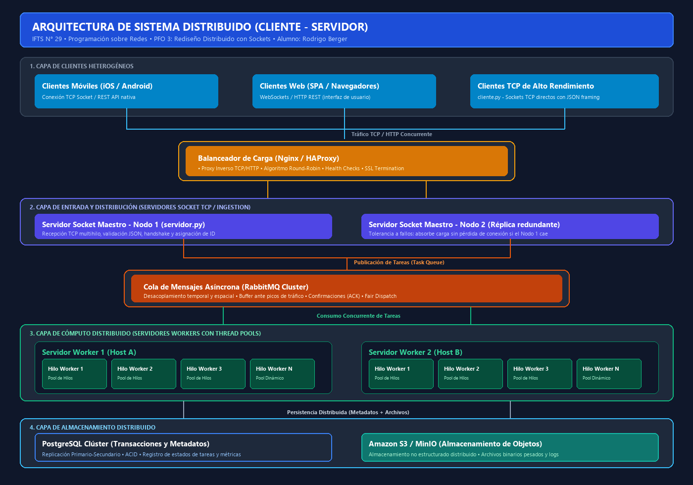

# PFO 3: Rediseño como Sistema Distribuido (Cliente-Servidor)

**Institución:** IFTS N.° 29  
**Materia:** Programación sobre redes - 3.° D  
**Alumno:** Rodrigo Berger  
**Tecnologías:** Python 3, Sockets TCP/IP (`socket`), Multihilo (`threading`), Colas Sincronizadas (`queue.Queue`), Serialización (`json`).

---

## 📌 Descripción del Proyecto

El objetivo de este trabajo práctico es rediseñar y transformar el sistema cliente-servidor en una **arquitectura distribuida** usando sockets TCP en Python.

El sistema se compone de:
1. **`servidor.py`**:
   - Escucha conexiones TCP en `localhost:5000`.
   - Implementa un **Pool de Workers** (`NUM_WORKERS = 3`) usando hilos (`threading.Thread`) y una cola sincronizada (`queue.Queue`).
   - Cada conexión entrante de cliente es atendida en un hilo independiente (`daemon=True`) para no bloquear el socket principal.
   - Recibe tareas en formato JSON, las encola en la cola de trabajo, y un worker disponible las toma, las procesa y devuelve la respuesta al cliente.
   - Manejo de tareas: conteo léxico de palabras, cálculo de números primos (CPU) y simulación de persistencia distribuida.
   - Manejo de errores: reutilización de puerto (`SO_REUSEADDR`), desconexión abrupta y apagado con `Ctrl+C`.

2. **`cliente.py`**:
   - Se conecta al servidor en `localhost:5000`.
   - Ofrece un menú interactivo por consola para elegir y enviar tareas.
   - Envía los datos codificados en JSON y recibe el resultado procesado por el worker correspondiente.
   - Finaliza la sesión cuando el usuario escribe **`éxito`** o `salir`.

---

## 🗺️ Diagrama de la Arquitectura Distribuida

En cumplimiento con la consigna, se diseñó el diagrama del sistema incluyendo todos los componentes requeridos:



### Explicación de los Componentes:

1. **Clientes (móviles y web):**  
   Dispositivos y aplicaciones que envían peticiones y tareas al sistema (clientes móviles Android/iOS, navegadores web o scripts cliente TCP).
2. **Balanceador de Carga (Nginx / HAProxy):**  
   Punto de entrada que distribuye las conexiones entrantes entre los servidores disponibles usando algoritmos como *Round-Robin*, evitando la sobrecarga de un único nodo.
3. **Servidores Workers (con Pool de Hilos):**  
   Servidores encargados del procesamiento. Cada uno cuenta con un conjunto de hilos trabajadores (*worker pool*) que consumen tareas de forma concurrente sin crear hilos infinitos.
4. **Cola de Mensajes (RabbitMQ):**  
   Permite la comunicación asíncrona y el desacoplamiento entre los servidores que reciben las peticiones y los workers que las procesan, funcionando como un buffer ante picos de demanda.
5. **Almacenamiento Distribuido (PostgreSQL, S3):**  
   - **PostgreSQL:** Base de datos relacional para guardar metadatos de las tareas, usuarios y transacciones (garantía ACID).
   - **Amazon S3 / MinIO:** Almacenamiento de objetos no estructurados para archivos de gran volumen y reportes.

---

## 🚀 Guía de Ejecución

### 1. Iniciar el Servidor
Abre una terminal y ejecuta:
```bash
python servidor.py
```

*Salida esperada:*
```text
============================================================
   SERVIDOR DISTRIBUIDO CON POOL DE WORKERS
   Materia: Programación sobre Redes - IFTS N° 29
   Alumno: Rodrigo Berger
============================================================
[SISTEMA] Creando pool de 3 workers...
[WORKER 1] Iniciado y listo para recibir tareas.
[WORKER 2] Iniciado y listo para recibir tareas.
[WORKER 3] Iniciado y listo para recibir tareas.
[SERVIDOR] Escuchando conexiones en localhost:5000...
```

### 2. Iniciar el Cliente
Abre **otra terminal** distinta y ejecuta:
```bash
python cliente.py
```

*Ejemplo de interacción:*
```text
============================================================
   CLIENTE TCP DISTRIBUIDO - ENVÍO DE TAREAS
   Materia: Programación sobre Redes - IFTS N° 29
   Alumno: Rodrigo Berger
============================================================
Conectando al servidor en localhost:5000...
[ÉXITO] Conexión establecida con el servidor localhost:5000.

--------------------------------------------------
      MENÚ DE TAREAS - CLIENTE DISTRIBUIDO
--------------------------------------------------
1. Contar palabras y caracteres de un texto
2. Calcular números primos hasta un límite
3. Simular almacenamiento de archivo (PostgreSQL + S3)
4. Salir (o escribe 'éxito')
--------------------------------------------------
Elige una opción (1-4) > 1

Ingresa el texto a procesar > Los sistemas distribuidos dividen tareas en workers

✔ Atendido por: Worker-1 (en 0.05 ms)
  Resultado: {'total_caracteres': 50, 'total_palabras': 8}
```

Para salir del cliente:
```text
Elige una opción (1-4) > 4

[INFO] Desconexión solicitada. Finalizando sesión...
[INFO] Socket cliente cerrado correctamente.
```

---

## 🧪 Pruebas y Casos de Error Manejados

- **Puerto Ocupado (`OSError`):** Configuración de `SO_REUSEADDR` en el socket del servidor para liberar y reutilizar el puerto inmediatamente si se reinicia.
- **Servidor Apagado (`ConnectionRefusedError`):** Si el cliente intenta conectarse antes de encender el servidor, atrapa la excepción y muestra un mensaje amigable indicando que primero debe iniciar `servidor.py`.
- **Concurrencia Segura:** La cola de tareas (`queue.Queue`) es *thread-safe* por diseño en Python, garantizando que dos workers nunca tomen la misma tarea a la vez.
- **Desconexión Limpia y Abrupta:** Si el cliente se desconecta con `éxito` o se cierra la terminal forzadamente (`ConnectionResetError`), el hilo del servidor cierra el socket sin interrumpir al resto de los clientes.
